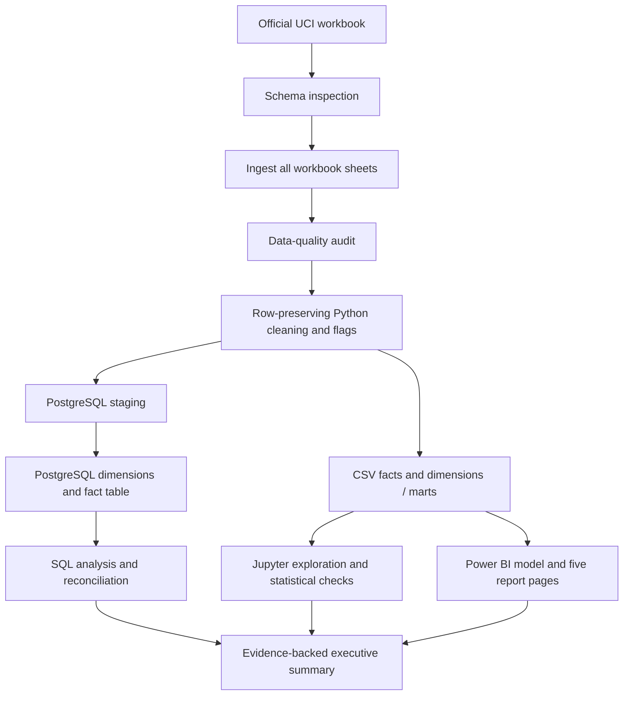

# RetailSignal

**E-commerce Revenue, Customer Retention & Market Performance Intelligence**

RetailSignal is a reproducible business analytics case study built around the UCI Machine Learning Repository's **Online Retail II** dataset. It is designed to show how a junior analyst can move from source-data inspection to transparent cleaning rules, reconciled SQL metrics, customer analytics, statistical checks, and an executive-facing Power BI design.

> **Evidence status:** The official UCI Online Retail II workbook has been executed end-to-end in CI: all 1,067,371 source rows were preserved, 15 marts were generated, PostgreSQL 16 SQL executed, and Python/PostgreSQL financial totals reconciled. Full product parity passed: **4,916/4,916 products match with zero mismatches** in [real-data CI run 40089797883](https://github.com/sinanaghdi/retailsignal/actions/runs/40089797883). The Python suite passed 45 tests on each of Python 3.12 and 3.13 in [CI run 40089797929](https://github.com/sinanaghdi/retailsignal/actions/runs/40089797929). See [the real-data report](reports/real_dataset_benchmark.md). This historical dataset does not prove current market demand or business impact.

## Business questions

- How did recorded sales, eligible positive line sales, and invoice volume move over time?
- Which products and countries contribute most to eligible positive line sales?
- How concentrated are sales across products and identified customers?
- What share of identifiable purchasers made two or more eligible purchases during the observation window?
- How does repeat-purchase activity vary across first-purchase cohorts?
- How are cancellation-prefixed invoices, negative quantities, negative line values, and data-quality issues distributed?
- Which findings support a defensible next commercial test, and what data is missing for profit, CAC, or marketing ROI?

## Project features

- Schema inspection before full ingestion; documented UCI aliases are normalized only after the schema gate passes.
- Row-preserving data audit with row counts, affected percentages, treatment rationale, exact-duplicate candidates, invalid values, and invoice-level inconsistencies.
- Explicit `line_value = quantity × unit_price`; positive-sales, cancellation-prefix, negative-quantity, and negative-line flags remain distinct.
- Data marts for monthly performance, products, countries, customers, RFM, and customer cohorts.
- PostgreSQL staging/star-schema DDL, transformations, reconciliation checks, window-function analysis, retention SQL, and contribution rankings.
- Unit tests using **clearly synthetic fixtures only**; these are not business data or a substitute for the UCI dataset.
- Power BI executive dashboard specification, DAX definitions, and a local preflight utility with synthetic-fixture tests. A `.pbix` file has not been created in this environment; follow [`powerbi/LOCAL_BUILD.md`](powerbi/LOCAL_BUILD.md) to prepare and validate the local inputs.

## Dataset and attribution

- Source: [UCI Online Retail II](https://archive.ics.uci.edu/dataset/502/online+retail+ii)
- Citation: Chen, D. (2012). *Online Retail II* [Dataset]. UCI Machine Learning Repository. [https://doi.org/10.24432/C5CG6D](https://doi.org/10.24432/C5CG6D)
- License: UCI lists the data under [CC BY 4.0](https://creativecommons.org/licenses/by/4.0/). Retain attribution when redistributing any permitted dataset-derived material.
- Price currency: GBP sterling. Values in this project are recorded transaction-line values, not recognized accounting revenue, profit, or cash collected.

Do **not** commit the workbook or derived customer-level records to GitHub. See [`docs/setup.md`](docs/setup.md) for manual download steps.

## Quick start (Windows PowerShell)

```powershell
# From the folder containing this repository
py -3.12 -m venv .venv
.\.venv\Scripts\Activate.ps1
python -m pip install --upgrade pip
pip install -r requirements.txt

# Download the official UCI workbook ZIP, extract only the expected workbook, and validate headers.
python -m src.download_data

# Inspect workbook structure BEFORE full ingestion:
python -m src.ingest --inspect-only

# Only after the schema check succeeds:
python -m src.ingest
python -m src.validate
python -m src.clean
python -m pytest -q
python -m src.statistics
python powerbi/prepare_data_model.py
```

Project charter and acceptance criteria: [`docs/project_charter.md`](docs/project_charter.md). The latest Python 3.12/3.13 suite passed with 45 tests each in [CI run 40089142207](https://github.com/sinanaghdi/retailsignal/actions/runs/40089797929). The real UCI + PostgreSQL end-to-end workflow passed in [CI run 40089142209](https://github.com/sinanaghdi/retailsignal/actions/runs/40089797883), including 7 reconciliation checks, 10 source checks, and full product parity: 4,916/4,916 products matched across the compared fields. Detailed evidence: [`reports/real_dataset_benchmark.md`](reports/real_dataset_benchmark.md). Power BI `.pbix` build and visual verification remain pending. Instructions: [`docs/setup.md`](docs/setup.md), [`docs/architecture.md`](docs/architecture.md), and [`powerbi/README.md`](powerbi/README.md).

## Pipeline outputs

| Output | Purpose |
|---|---|
| `data/raw/source_manifest.json` | Local acquisition provenance, schema headers, file sizes, and SHA-256 values (created after downloader success; not committed) |
| `data/processed/01_ingested.csv` | Canonical headers and source-row provenance; no rows intentionally removed |
| `data/processed/data_quality_audit.csv` / `.json` | Counts, percentages, treatment rationale, and audit metadata |
| `data/processed/fact_sales_lines.csv` | Cleaned, row-preserving line fact with flags and signed line values |
| `data/marts/monthly_sales.csv` | Monthly net recorded value, gross positive line sales, negative-line value, volumes, and MoM metrics |
| `data/marts/customer_rfm.csv` | Identified-customer recency, invoice frequency, recorded monetary value, scores, and behavioral labels |
| `data/marts/customer_rfm_sensitivity.csv` | Compare RFM monetary scores/segments under signed versus positive-only monetary definitions |
| `data/marts/customer_concentration.csv` | Ranked positive-sales contribution among reliably identified customers |
| `data/marts/duplicate_sensitivity.csv` | Core metrics with all rows versus excluding duplicate-candidate extras (sensitivity only) |
| `data/marts/customer_rfm_segment_summary.csv` | Frequency, recency, and recorded monetary summaries by rule-based segment |
| `data/marts/cohort_retention.csv` | Long-format cohort activity, elapsed month index, and observed activity rate |
| `data/marts/product_performance.csv` / `country_performance.csv` | Rankings and contribution metrics under the documented eligible-sales rule |
| `data/processed/statistical_checks.json` | Results and limitations of prespecified nonparametric checks |
| `data/marts/powerbi_date.csv` | Generated contiguous date dimension for the Power BI model (local only) |
| `data/processed/powerbi_model_validation.json` | Local Power BI input-schema, metric-reconciliation, and date-coverage preflight report (local only) |

Generated data directories are ignored by Git. Keep only the small, non-sensitive project code and documentation in the repository.

## Metric rules at a glance

- **Signed line value:** `Quantity × UnitPrice`, including negative values once.
- **Gross positive line sales:** line value where quantity > 0, unit price > 0, and invoice identifier does not start with `C`.
- **Net recorded line value:** sum of all non-null signed line values in the selected population; do not subtract negative lines again.
- **Cancellation-related:** invoice identifier begins with `C` after trimming and case normalization. This is a source convention, not proof of physical return completion.
- **Repeat purchaser:** identified `CustomerID` with at least two distinct eligible purchase invoices in the observed history.
- **RFM monetary:** signed line value on non-cancellation invoices for identified customers; interpretation is bounded by missing IDs and incomplete history.

The complete metric dictionary, cohort window caveats, and denominator definitions are in [`reports/methodology.md`](reports/methodology.md) and [`reports/data_dictionary.md`](reports/data_dictionary.md).

## Architecture



## Repository map

```text
retailsignal/
├── README.md, LICENSE, requirements.txt, .env.example, .gitignore
├── config/
├── data/{raw,processed,marts}/          # local data; ignored by Git
├── notebooks/                           # quality, EDA, customer analysis
├── src/                                 # ingestion, audit, cleaning, metrics, PostgreSQL utilities
├── sql/                                 # schema, transformations, sales/customer/cohort/product/quality queries
├── tests/                               # synthetic unit tests only
├── powerbi/                             # model, layout, DAX, and validation notes
├── reports/                             # methods, limitations, data dictionary, findings status
├── presentation/                        # case-study outline, LinkedIn copy, interview walkthrough
└── docs/                                # charter, setup, and architecture
```

## Validation status

- **Real source executed:** UCI Online Retail II; 1,067,371 source rows preserved and 15 analytical marts generated. See [the real-data report](reports/real_dataset_benchmark.md).
- **Automated tests:** 45 tests passed on Python 3.12 and 45 on Python 3.13 in [CI run 40089142207](https://github.com/sinanaghdi/retailsignal/actions/runs/40089797929).
- **End-to-end acceptance:** PostgreSQL 16 staging/fact totals and eligible positive sales reconciled; SQL files 02–07 executed; 7 PostgreSQL checks and 10 source checks passed. Full product parity was verified with 4,916/4,916 rows matched and zero mismatches in [CI run 40089142209](https://github.com/sinanaghdi/retailsignal/actions/runs/40089797883).
- **Power BI preflight:** `powerbi/prepare_data_model.py` checks local exports, the positive-sales/cancellation rules, amount arithmetic, dimension key uniqueness, monthly-to-fact reconciliation, and generates a contiguous Date table. Its tests use synthetic fixtures; it has not yet been run against local full-data exports in this environment.
- **Still pending:** build and visual verification of the Power BI `.pbix` file in Power BI Desktop. Real-data analysis is descriptive and does not prove causal or commercial impact. See [`powerbi/LOCAL_BUILD.md`](powerbi/LOCAL_BUILD.md).

Do not convert a pending item into a portfolio claim until its evidence has been generated and reviewed. For implementation gaps and release criteria, see [`reports/limitations.md`](reports/limitations.md).

## Suggested GitHub topics

`data-analysis`, `sql`, `python`, `pandas`, `postgresql`, `power-bi`, `customer-retention`, `cohort-analysis`, `rfm-analysis`, `e-commerce-analytics`, `business-intelligence`


## Repository and local development

This project is published at **[github.com/sinanaghdi/retailsignal](https://github.com/sinanaghdi/retailsignal)**.

To work on the project locally, clone the existing repository rather than initializing a separate Git history:

```powershell
git clone https://github.com/sinanaghdi/retailsignal.git
Set-Location retailsignal
py -3.12 -m venv .venv
.\.venv\Scripts\Activate.ps1
pip install -r requirements.txt
```

After a change, run the relevant tests, inspect `git status` to confirm no raw workbook, generated customer-level exports, or `.env` file is staged, then commit and push your branch. The `scripts/publish_to_github.ps1` bootstrap helper intentionally refuses to create a parallel history; use the existing clone for subsequent work.

**Publication boundary:** source code, documentation, SQL, notebooks, and synthetic unit fixtures are versioned. The official workbook and generated transaction/customer-level outputs are excluded by `.gitignore`. Aggregate real-data evidence and PostgreSQL reconciliation are documented in [`reports/real_dataset_benchmark.md`](reports/real_dataset_benchmark.md); Power BI `.pbix` build and visual verification remain pending.
