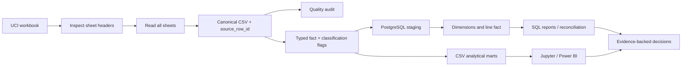

# Architecture and Modeling Decisions

## Data flow

## Primary grain

`fact_sales_line` is at **one source worksheet row per fact row**. `source_row_id` is a project trace key and not a source-system business key. Every ingested row is retained by the primary transformation. A candidate exact duplicate is annotated for sensitivity analysis but not automatically removed.

## Core entities

- `stg_online_retail`: typed source fields and provenance before dimensional transformation.
- `dim_invoice`: one row per nonblank invoice identifier, with deterministic summaries and variation counts for date/customer/country fields.
- `dim_product`: one row per nonblank stock code; description is representative text and may vary in source rows.
- `dim_customer`: one row per nonblank source `CustomerID`.
- `dim_country`: one row per nonblank country label.
- `fact_sales_line`: source-line grain; retains line date/customer/country as observed and refers to dimensions where keys are present.

## Why no global deletion

Missing customer IDs prevent customer-level analysis but do not invalidate known sales lines. Negative quantities and cancellation-prefixed invoice IDs are operational signals, not universal exclusion criteria. Nonpositive prices and outliers may represent unusual legitimate records. The project flags them and uses explicitly scoped metrics instead of altering the source history.

## Revenue vocabulary

Every measure is named according to what the source supports. “Recorded sales” is not interchangeable with recognized accounting revenue. “Gross positive line sales” is a rule-based sum of positive quantity × positive price outside cancellation-prefixed invoices; it is not gross profit. `net_recorded_sales_gbp` is the signed sum of recorded line values, including negative amounts once. No cost, expense, acquisition, campaign, or payment-settlement data is provided.

## Reconciliation controls

1. Count rows per workbook sheet and source CSV.
2. Preserve source row count through Python cleaning.
3. Assert `line_value == quantity * unit_price` for valid pairs.
4. Compare staging and fact row counts in PostgreSQL.
5. Compare staging signed sum and fact signed sum.
6. Measure invoice attribute variations before relying on invoice-level customer attribution.
7. Compare Power BI measures with independently calculated Python/SQL totals.

## Known data-model caveat

If a single invoice identifier has multiple nonmissing customer, country, or date values, `dim_invoice` uses a deterministic `MIN` representative while exposing variant counts. Line-grain fact fields are retained. Such invoices must be reviewed before using the invoice dimension for customer attribution; the representative is a technical fallback, not a claim about the correct source value.
